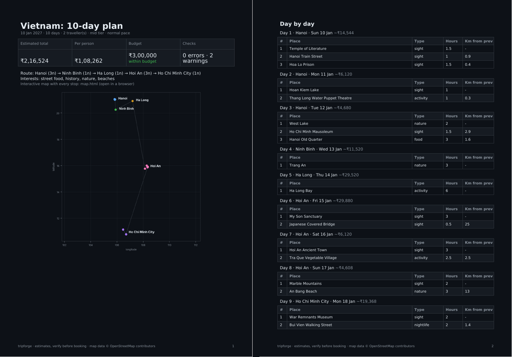
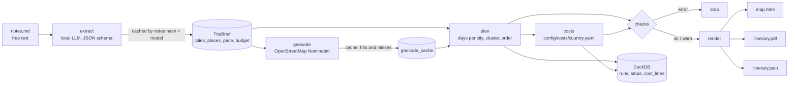

# tripforge

Rough trip notes in. Day-by-day itinerary, interactive map and a costed PDF out.

```text
$ make demo
brief: Vietnam, 10 days, 5 cities, 24 places (brief file)
seed: 24 coordinates
geocode: 24 found, 0 missing, 0 API calls
  warn  capacity: did not fit the pace: Hang Mua, Tam Coc, Sung Sot Cave, Ba Na Hills
  warn  long_leg: day 10: Ben Thanh Market (48.5 km)
total ≈ ₹216,524 (2 pax)
out/vietnam/itinerary.pdf
out/vietnam/map.html
```



Full sample: [docs/vietnam-sample.pdf](docs/vietnam-sample.pdf)

## Why

Every trip I plan starts as a messy note: "Hanoi 3 nights, street food is a must, maybe Ba Na
Hills, 1.5L each". Turning that into days, a route and a real budget takes an evening of
tabs and spreadsheets. This does it in one command, and shows its working: where every place
came from, how every rupee was computed, and what didn't fit.

## How it works



| Stage | What happens | Why it is built this way |
| --- | --- | --- |
| Extract | A local LLM (Ollama) turns notes into a `TripBrief` constrained by a JSON schema, `temperature=0`. Pydantic validates it. CLI flags (`--days`, `--budget`) override the model. | Output is untrusted until validated. Same notes + same model = cache hit, no second LLM call. |
| Geocode | Each place is looked up on Nominatim, max 1 request per second with an identifying User-Agent, as its usage policy requires. Hits and misses are cached. | Re-runs cost zero API calls; a typo is not looked up 50 times. |
| Plan | Each city gets its nights as days; the arrival day has half the time. Places are swept around the city centre so neighbours share a day, balanced to the pace (5/7/9 h), then ordered nearest-neighbour. Must-see places can evict optional ones. Nightlife goes last. | Pure function, deterministic, tested. |
| Costs | Stay, food, local transport per tier, inter-city legs, entry fees, international flights, buffer. All from one YAML file per country, converted to INR at a dated rate. | Every PDF line shows its basis. A missing price is flagged, never guessed. |
| Checks | Errors stop the run: more than 30% of places not found, a must-see dropped. Warnings go in the PDF: overflow, long legs, budget overrun, nights vs days, cost gaps. | Same idea as a data-quality gate before publishing a table. |
| Render | Dark PDF (summary, route chart, day plans, costs, checks, assumptions); Leaflet map with a layer per day; JSON for anything downstream. | |

Every run is stored in DuckDB (`runs`, `itinerary_stops`, `cost_lines`), so trips can be
compared with SQL.

## Quickstart

```bash
curl -LsSf https://astral.sh/uv/install.sh | sh
ollama pull qwen3:8b

cd tripforge
make setup
make demo        # Vietnam sample, fully offline: cached brief + seeded coordinates
open out/vietnam/itinerary.pdf out/vietnam/map.html
```

Your own trip:

```bash
uv run tripforge trips/japan.md --days 8 --travelers 2 --budget 400000 --tier mid --start 2027-04-02
```

A new country needs `config/costs/<country>.yaml`; copy `vietnam.yaml` and change the numbers.

| Flag | Meaning |
| --- | --- |
| `--days --travelers --budget --tier --pace` | override what the LLM read from the notes |
| `--start YYYY-MM-DD` | put dates on every day |
| `--refresh` | ignore the cached extraction, ask the LLM again |
| `--brief file.json` | skip the LLM, use a brief you wrote or edited |
| `--seed file.csv --offline` | known coordinates, no network |

## Data model

| Table | Grain | Key |
| --- | --- | --- |
| `extractions` | one notes text + overrides + model | `(input_hash, model)` |
| `geocode_cache` | one place query | `query`; `source` = nominatim / seed / miss |
| `runs` | one CLI run | `run_id` |
| `itinerary_stops` | one stop on one day | `(run_id, day, seq)` |
| `cost_lines` | one priced item | `(run_id, day, category, item)` |

## Tests

```bash
make test
```

20 tests: day allocation covers every day, must-see places always scheduled, day budgets
respected, nightlife last, deterministic output, geocode cache for hits and misses, rate limit
at ≥ 1 s between calls, offline mode never touches the network, extraction cache keyed on notes
and overrides, invalid LLM output rejected and not cached, stay nights = days − 1, missing
transfer price flagged, checks severities, PDF and map produced, Indian number format.

## Limits

- Distances are straight-line, not road. A 48 km leg in Saigon is Cu Chi, which is a half-day trip.
- Cost tiers are averages of published 2026 ranges. Check real hotel and flight prices before booking.
- The sample coordinates in `examples/vietnam/geocode_seed.csv` are approximate; a live run
  replaces them with Nominatim results.

## Roadmap

- [ ] Road distances and travel times from OSRM
- [ ] Opening hours from OpenStreetMap tags; skip places closed on that weekday
- [ ] Weather by date (Open-Meteo) to swap beach and museum days
- [ ] Streamlit form instead of a notes file

## Sources

- Nominatim usage policy: max 1 request/s, identifying User-Agent, cache results
- Vietnam cost tiers: 2026 ranges published by travel-cost guides (accommodation, food, Grab)
- VND/INR: mid-market rate, November 2026

Map data © OpenStreetMap contributors.
